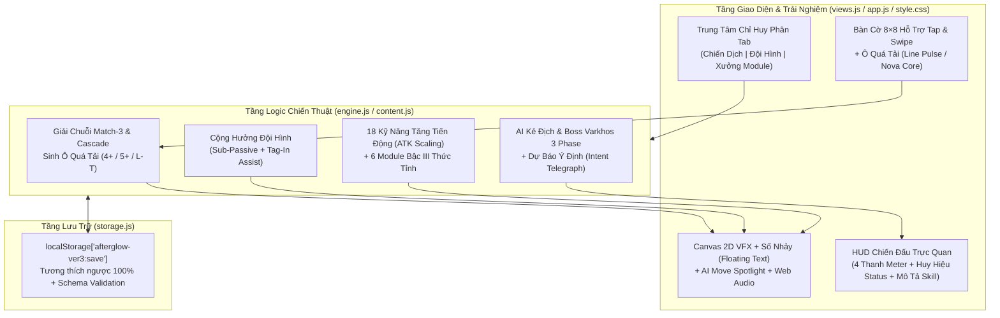

# SPEC: Nâng Cấp Toàn Diện `ver3` — Biệt Đội Dư Quang: Đêm Cuối Cùng (Afterglow v3.5)

> **Trạng thái:** `DRAFT — Chờ duyệt (Phase 0 & Phase 1)`
> **Phạm vi:** Toàn bộ thư mục [`ver3/`](file:///d:/xampp/htdocs/12suquan/ver3) (`index.html`, `src/content.js`, `src/engine.js`, `src/views.js`, `src/app.js`, `src/effects.js`, `src/storage.js`, `src/style.css`, `tests/*`).
> **Mục tiêu cốt lõi:** Nâng cấp toàn diện trò chơi chiến thuật giải đố RPG `ver3` trên 4 trụ cột: **Lối chơi (Gameplay & Chiều sâu chiến thuật)**, **Giao diện & Trải nghiệm người dùng (UI/UX & HUD)**, **Hệ thống Kỹ năng & Module (Skills & Loadout)**, và **Hoạt ảnh / Hiệu ứng / Âm thanh (Animations, VFX & Audio)**, đồng thời bảo toàn 100% dữ liệu lưu (`localStorage['afterglow-ver3:save']`) và khả năng chạy độc lập 0-dependency.

---

## 0. Bản Đồ Năng Lực (Phase 0: Capability Map)

Do yêu cầu nâng cấp bao phủ 4 mảng độc lập có thể kiểm thử riêng biệt, hệ thống được phân rã thành **4 Module Năng Lực (Capabilities)**:

| Mã Module | Tên Module | Phụ thuộc | Tập tin tác động chính | Mục tiêu kiểm thử độc lập |
| :--- | :--- | :--- | :--- | :--- |
| **`M1: gameplay-core`** | **Chiều sâu Bàn cờ, Cộng hưởng Đội hình & AI** | — | [`src/engine.js`](file:///d:/xampp/htdocs/12suquan/ver3/src/engine.js), [`src/content.js`](file:///d:/xampp/htdocs/12suquan/ver3/src/content.js), [`src/storage.js`](file:///d:/xampp/htdocs/12suquan/ver3/src/storage.js) | Ô Đặc Biệt (Overcharged Tiles khi nối 4/5/L-T), Tag-In Assist khi đổi Chỉ huy, Nội tại phụ đội hình (Sub-Passive), AI Telegraph (báo trước hành động địch). |
| **`M2: skills-and-modules`** | **Hệ thống 18 Kỹ năng Tăng tiến & Xưởng Module Thức tỉnh** | `M1` | [`src/content.js`](file:///d:/xampp/htdocs/12suquan/ver3/src/content.js), [`src/engine.js`](file:///d:/xampp/htdocs/12suquan/ver3/src/engine.js) | Kỹ năng tăng tiến theo `ATK` + cấp độ nhân vật, hiệu ứng phụ đặc trưng cho 18 skill, 6 Module bậc III kích hoạt hiệu ứng **Thức Tỉnh (Awakened)**. |
| **`M3: ui-ux-and-hud`** | **Tái thiết Giao diện Trung tâm Chỉ huy & HUD Chiến đấu** | `M1`, `M2` | [`src/views.js`](file:///d:/xampp/htdocs/12suquan/ver3/src/views.js), [`src/style.css`](file:///d:/xampp/htdocs/12suquan/ver3/src/style.css), [`src/app.js`](file:///d:/xampp/htdocs/12suquan/ver3/src/app.js) | Điều hướng phân tầng gọn gàng ở Command Center, thanh tiến trình Khiên & Pin trực quan, huy hiệu trạng thái có bộ đếm lượt, mô tả kỹ năng hiển thị trực tiếp (không phụ thuộc hover), ngăn kéo thông tin (Drawer) cho Mobile. |
| **`M4: vfx-animations-audio`** | **Hoạt ảnh Bàn cờ Mượt mà, VFX Canvas 2D & Âm thanh Đa tầng** | `M1`, `M3` | [`src/effects.js`](file:///d:/xampp/htdocs/12suquan/ver3/src/effects.js), [`src/app.js`](file:///d:/xampp/htdocs/12suquan/ver3/src/app.js), [`src/style.css`](file:///d:/xampp/htdocs/12suquan/ver3/src/style.css) | Cập nhật DOM từng phần (tránh xóa trắng `#app`), hoạt ảnh trượt ô (swap/invalid shake), **AI Move Spotlight** (soi nước đi của địch), hiệu ứng nổ ô theo vùng skill, VFX Canvas riêng cho 6 tướng & Boss, synthesizer đa âm sắc. |

---

## 1. Phân Tích Hiện Trạng & Điểm Nghẽn Của `ver3`

Qua quá trình đọc toàn bộ mã nguồn và kiểm tra ảnh chụp giao diện thực tế ([`home-1440.png`](file:///d:/xampp/htdocs/12suquan/ver3/evidence/home-1440.png), [`battle-1440.png`](file:///d:/xampp/htdocs/12suquan/ver3/evidence/battle-1440.png), [`battle-375.png`](file:///d:/xampp/htdocs/12suquan/ver3/evidence/battle-375.png), [`skill-prism.png`](file:///d:/xampp/htdocs/12suquan/ver3/evidence/skill-prism.png)), phiên bản `ver3` hiện tại có nền tảng kiến trúc sạch sẽ nhưng tồn tại **4 nhóm hạn chế lớn**:

### 1.1. Lối chơi (Gameplay) còn phẳng, thiếu đột biến
1. **Nối 4, nối 5 chỉ cộng 1 lượt, không sinh Ô Đặc Biệt:** Trong [`resolve()`](file:///d:/xampp/htdocs/12suquan/ver3/src/engine.js#L69-L90), mọi chuỗi nối `>= 4` chỉ đặt `extra = true`, còn [`collect()`](file:///d:/xampp/htdocs/12suquan/ver3/src/engine.js#L168-L185) thu hoạch mọi ô giống hệt nhau. Bàn cờ thiếu hẳn các **Ô Cộng Hưởng / Ô Quá Tải (Special Tiles)** như *Xung Ngang/Dọc* (nối 4) hay *Lõi Siêu Tân Tinh* (nối 5 / chữ L / chữ T) để tạo chuỗi nổ liên hoàn giống như *Kiếm Lửa* của bản J2ME gốc.
2. **Đổi Chỉ huy (`switchHero`) thiếu tính chiến thuật:** Trong [`switchHero()`](file:///d:/xampp/htdocs/12suquan/ver3/src/engine.js#L263-L269), việc đổi giữa 3 thành viên trong đội chỉ đổi bộ 3 nút kỹ năng và nội tại đơn lẻ của người đứng đầu (`heroOf(s)`). Hai thành viên dự bị hoàn toàn "đứng nhìn", không đóng góp nội tại phụ hay đòn **Chi viện (Tag-In Assist)**.
3. **Kỹ năng không tăng tiến theo Cấp độ (Static Skill Values):** Toàn bộ 18 kỹ năng trong [`HEROES`](file:///d:/xampp/htdocs/12suquan/ver3/src/content.js#L14-L99) đều dùng con số cố định (`damage: 36`, `heal: 45`, `shield: 38`). Khi người chơi lên cấp cao hoặc sang Chương III (Màn 9–12, địch có `370–520 HP`), đòn nối ô cơ bản mạnh lên theo `attack`, nhưng sát thương/hồi máu của kỹ năng lại giữ nguyên khiến kỹ năng yếu dần về cuối game.
4. **Hành vi AI kẻ địch (`enemyStep`) khó theo dõi:** Trong [`enemyStep()`](file:///d:/xampp/htdocs/12suquan/ver3/src/engine.js#L329-L361), kẻ địch tự động đổi 2 ô và giải bàn cờ ngay trong 1 lần gọi hàm sau `650ms` mà **không hiển thị kẻ địch vừa đổi 2 ô nào**, cũng không báo trước (telegraph) ý định sắp tung giao thức đặc biệt khi đầy năng lượng.

### 1.2. UI/UX & HUD còn bất tiện trên cả Desktop và Mobile
1. **Render lại toàn bộ `#app.innerHTML` mỗi thao tác:** Trong [`render()`](file:///d:/xampp/htdocs/12suquan/ver3/src/app.js#L35-L45), mỗi lần chọn 1 ô (`clickTile`), đổi tướng, hay qua lượt đều gán lại toàn bộ `$('app').innerHTML`. Điều này làm mất vị trí cuộn, giật khung hình và triệt tiêu khả năng chạy CSS transition mượt cho thanh máu/năng lượng/bàn cờ.
2. **Chỉ số Khiên (`shield`) và Pin (`battery`) thiếu thanh đo trực quan:** Trong [`fighter()`](file:///d:/xampp/htdocs/12suquan/ver3/src/views.js#L71-L82), chỉ có HP và Mana có thanh `.meter`. Khiên (`0..100`) và Pin (`0..100`, về `0` bị phạt `-10 HP/lượt`) chỉ là dòng chữ nhỏ `◇ 0 khiên | ▰ 60 pin`, rất dễ bị người chơi bỏ sót khi đang tập trung nhìn bàn cờ.
3. **Mô tả kỹ năng bị ẩn trên thiết bị cảm ứng (Mobile):** Nút `.skill-btn` trong [`views.js`](file:///d:/xampp/htdocs/12suquan/ver3/src/views.js#L93-L98) chỉ hiển thị tên kỹ năng + năng lượng (`⚡18`), còn công dụng thực sự bị nhét vào thuộc tính `title="${k.text}"` — hoàn toàn vô hình trên điện thoại!
4. **Mobile ẩn mất Nhật ký chiến đấu, Module và Nội tại:** Trong [`style.css`](file:///d:/xampp/htdocs/12suquan/ver3/src/style.css#L172), quy tắc `@media (max-width:760px)` đặt `.player .journal, .enemy .journal, .fighter .passive { display: none }`, khiến người chơi trên điện thoại không biết mình đang mang nội tại gì, module nào, hay địch vừa làm gì.
5. **Trung tâm chỉ huy (`command` view) trải dài trên 1 trang cuộn dọc:** Chọn Đội hình (6 thẻ lớn) + Chiến dịch (12 màn +简 báo) + Xưởng Module (6 thẻ) xếp chồng lên nhau làm người chơi phải cuộn nhiều lần.

### 1.3. Hoạt ảnh & Hiệu ứng (`effects.js`) quá đơn giản
1. **Canvas VFX chỉ có 21 dòng mã ([`src/effects.js`](file:///d:/xampp/htdocs/12suquan/ver3/src/effects.js#L1-L21)):** Hạt (particles) chỉ là các hình vuông `3×3px` (`fillRect`), hiệu ứng kỹ năng chỉ có 2 kiểu vẽ hình học đơn điệu (3 vòng tròn đồng tâm hoặc 3 vạch thẳng), và âm thanh chỉ là 1 tiếng bíp sóng sine đơn lẻ (`620Hz` hoặc `340Hz`).
2. **Bàn cờ tĩnh lặng khi thao tác:** Khi hoán đổi 2 ô hợp lệ hoặc không hợp lệ, ô nhảy vị trí tức thì mà không có hoạt ảnh trượt qua lại (swap/shake). Khi dùng kỹ năng phá hàng, phá cột, nổ 3×3 hoặc xóa màu ô, các ô biến mất ngay lập tức mà không có tia laser hay vùng sáng quét qua bàn cờ.

---

## 2. Đề Xuất Phương Án Nâng Cấp Toàn Diện (4 Trụ Cột)

### Trụ cột 1: Lối Chơi & Chiều Sâu Chiến Thuật (`M1: gameplay-core`)

#### 1.1. Hệ thống Ô Quá Tải — *Overcharged Tiles* (Tương tự nâng cấp từ *Kiếm Lửa* v1)
Khi người chơi ghép chuỗi từ 4 ô trở lên, thay vì chỉ xóa trắng toàn bộ, ô tại vị trí vừa hoán đổi sẽ kết tinh thành **Ô Quá Tải (Charged Tile)** mang ký hiệu và hào quang riêng trên bàn cờ (`boardMods[idx]`):
- **Nối 4 ô thẳng hàng → `Ô Xung Tuyến (Line Pulse - ⚡↔ / ⚡↕)`:** Khi được ghép trong lượt sau (hoặc bị kích nổ dây chuyền), ô này **phá hủy toàn bộ Hàng ngang hoặc Cột dọc** chứa nó, thu hoạch 100% tài nguyên của các ô bị phá và gây thêm `+12` sát thương lan.
- **Nối 5 ô hoặc giao điểm chữ L / chữ T → `Lõi Siêu Tân Tinh (Nova Core - ✦)`:** Khi kích hoạt, **nổ tung vùng 3×3 xung quanh**, hồi ngay `+6 Năng lượng`, `+6 Pin` và cộng thêm `+20%` hiệu quả cho toàn bộ tài nguyên thu được trong chuỗi đó.
- **Chuỗi Combo Liên Hoàn (Cascade Multiplier):** Mỗi tầng rơi liên tiếp (`cascade >= 2`) tăng hệ số nhân sát thương và hồi phục thêm **+15% mỗi tầng** (hiển thị bộ đếm `COMBO ×2`, `COMBO ×3!` rực sáng trên bàn cờ).

#### 1.2. Cơ chế Cộng Hưởng Đội Hình & Đòn Chi Viện (*Squad Resonance & Tag-In Assist*)
Biến việc xây dựng đội hình 3 người trở nên có chiều sâu thực sự:
- **Nội tại Đội hình (Sub-Passive):** Hai thành viên dự bị trong đội vẫn đóng góp **50% hiệu lực nội tại** (hoặc hiệu ứng cộng hưởng phụ) cho toàn đội, thay vì bị vô hiệu hóa khi không làm Chỉ huy.
- **Đòn Chi Viện Khi Đổi Chỉ Huy (`Tag-In Assist` — 1 lần miễn phí / 2 lượt):** Khi nhấn đổi sang một thành viên khác trong lượt của mình (và `battery >= 15`), tiêu hao nhẹ `10 Pin` để nhân vật mới lập tức tung **Hiệu ứng Chi Viện (Tag-In)**:
  - **Lyra (Kiếm Vệ):** *Trảm Xung Nhập Trường* — Chém ngay `12 + 25% ATK` sát thương vào địch.
  - **Sora (Khống Pháp):** *Nhiễu Sóng Tức Thời* — Hút `5 Năng lượng` của địch chuyển sang cho đội.
  - **Nham (Pháo Đài):** *Dựng Tường Chắn* — Cộng ngay `+16 Khiên` cho đội.
  - **Dạ (Thợ Săn):** *Đạn Đánh Dấu* — Bắn xuyên giáp `14` sát thương và gắn `1 lượt Đốt`.
  - **Kính (Quang Học):** *Khúc Xạ Năng Lượng* — Chuyển hóa ngẫu nhiên 2 ô trên bàn cờ thành ô `Năng lượng (⚡)` hoặc `Xung kích (⚔)`.
  - **Yên (Sinh Học):** *Phun Sương Cấp Cứu* — Hồi ngay `+18 HP` và `+8 Pin`.

#### 1.3. Hệ thống Báo Trước Ý Định Địch (*Enemy Intent Telegraph*)
- Trên thẻ Kẻ địch sẽ hiển thị rõ huy hiệu **Dự Báo Lượt Tới (Next Intent)**:
  - `⚔ Chuẩn bị càn quét bàn cờ` (khi `enemy.mana < 18`)
  - `⚠ SẮP TUNG GIAO THỨC: [Tên Kỹ Năng Địch]` (nhấp nháy cảnh báo đỏ khi `enemy.mana >= 18` hoặc khi Boss Varkhos chuẩn bị chuyển Phase), giúp người chơi chủ động bật Khiên của Nham, hút Mana bằng Sora, hoặc làm Choáng trước khi địch ra đòn.

---

### Trụ cột 2: Cải Tiến 18 Kỹ Năng & Hệ Thống Xưởng Module (`M2: skills-and-modules`)

#### 2.1. Công thức Tăng tiến Kỹ năng theo Cấp độ & Chỉ số (`Dynamic Scaling`)
Mọi kỹ năng sát thương, hồi máu và tạo khiên đều được nâng cấp từ số tĩnh sang công thức động:
$$\text{Giá trị thực tế} = (\text{Cơ bản} + \text{Hệ số} \times \text{ATK}) \times (1 + \text{Bonus Module})$$
Giúp kỹ năng luôn giữ vai trò quyết định từ Màn 1 đến Boss cuối Varkhos.

#### 2.2. Nâng cấp Chiều sâu cho 18 Kỹ năng của 6 Thành viên

| Nhân vật | Kỹ năng 1 (`10⚡`) | Kỹ năng 2 (`18⚡`) | Tuyệt kỹ 3 (`28⚡`, CD 4 lượt) |
| :--- | :--- | :--- | :--- |
| **Lyra** *(Kiếm Vệ)* | **Trảm Xung** (`36 + 0.5×ATK` sát thương, tạo 1 ô `⚔` trên bàn cờ) | **Lưỡi Quang** (Phá hàng giữa + gây `28 + 0.4×ATK` sát thương + nhận `+15 Khiên`) | **Thiên Đao** (`78 + 0.8×ATK` sát thương + `2 lượt Đốt`; **+35% sát thương nếu địch đang có Khiên**) |
| **Sora** *(Khống Pháp)* | **Tĩnh Điện** (`28 + 0.4×ATK` sát thương, hút `10⚡` của địch về cho đội) | **Khóa Mạch** (`22 + 0.3×ATK` sát thương, xóa toàn bộ ô `⚡` trên bàn cờ để tích lũy cho đội) | **Bão Từ** (`54 + 0.6×ATK` sát thương + **Choáng 1 lượt** + xóa 20 Khiên địch) |
| **Nham** *(Pháo Đài)* | **Tường Thạch** (`+38 + 0.5×ATK Khiên` + hồi `12 HP`) | **Chấn Địa** (Phá cột giữa + gây sát thương cộng thêm bằng **50% lượng Khiên hiện có**) | **Pháo Đài** (`+65 Khiên`, **Phản đòn 2 lượt**, miễn nhiễm giảm Pin trong 2 lượt) |
| **Dạ** *(Thợ Săn)* | **Đạn Lạc** (`34 + 0.5×ATK` sát thương **xuyên 100% Khiên**) | **Mưa Tên** (Nổ vùng 3×3 trung tâm + gắn `2 lượt Đốt`) | **Huyết Ảnh** (`86 + 0.9×ATK` sát thương xuyên Khiên; nếu địch `< 40% HP` hoặc đang `Đốt`, **hồi 35% sát thương gây ra thành HP**) |
| **Kính** *(Quang Học)* | **Khúc Xạ** (Chuyển 3 ô ngẫu nhiên thành `⚡` hoặc `◈` rồi thu hoạch toàn bộ ô `◈`, nhận `+10⚡`) | **Tụ Quang** (`+26 Khiên`, `+20 Pin`, giảm `1 lượt hồi chiêu` của Tuyệt kỹ đang chờ) | **Lăng Kính** (`64 + 0.7×ATK` sát thương + xóa hàng & cột giữa + tạo **1 Lõi Siêu Tân Tinh `✦`** ở tâm bàn cờ) |
| **Yên** *(Sinh Học)* | **Mầm Sống** (Hồi `45 + 0.6×ATK HP` + thanh lọc hiệu ứng xấu) | **Bào Tử** (Thu hoạch mọi ô `✚ Sinh lực` trên bàn cờ + gắn `2 lượt Đốt` độc sinh học lên địch) | **Tái Sinh** (Hồi `80 + 0.8×ATK HP` + `+35 Khiên` + `+25 Pin`) |

#### 2.3. Nâng cấp Xưởng Module — Hiệu ứng Thức Tỉnh Bậc III (*Awakened Tier III Bonus*)
Khi người chơi nâng cấp bất kỳ Module nào trong 6 Module (`edge`, `aegis`, `well`, `seed`, `cell`, `lens`) lên **Bậc III (Tối đa)**, ngoài chỉ số cộng thêm, Module đó mở khóa **Đặc tính Thức Tỉnh (Awakened Passive)**:
1. **Lưỡi Hội Tụ III (`edge`):** Kỹ năng tấn công có **25% tỷ lệ Chí Mạng (×1.35 sát thương)** và **Hút máu 12%** lượng sát thương kỹ năng gây ra.
2. **Giáp Từ Trường III (`aegis`):** Mỗi đầu lượt của người chơi tự động tái tạo **+8 Khiên**; khi Khiên bị vỡ hoàn toàn, phóng xung điện gây `18` sát thương phản ngược.
3. **Giếng Quang Năng III (`well`):** Dùng bất kỳ kỹ năng nào cũng hoàn trả lại **+4 Năng lượng**; giảm tiêu hao Tuyệt kỹ số 3 từ `28⚡` xuống `25⚡`.
4. **Hạt Giống Sinh Học III (`seed`):** Khi HP xuống dưới `35%`, kích hoạt **Lá Chắn Sinh Học Khẩn Cấp** (1 lần/trận): hồi ngay `+45 HP` và `+25 Khiên`.
5. **Pin Dự Phòng III (`cell`):** Đổi Chỉ huy (`Tag-In Assist`) **không tốn Pin** và cộng thêm `+5 Năng lượng` mỗi lần đổi người.
6. **Thấu Kính Định Hướng III (`lens`):** Ngay khi bắt đầu trận đấu, tự động nạp sẵn **1 Ô Xung Tuyến (`⚡↔`)** trên bàn cờ; chuỗi nối 4+ cộng thêm `+4 Tín dụng` & `+4 Dữ liệu`.

---

### Trụ cột 3: Tái Thiết Giao Diện & Trải Nghiệm Người Dùng (`M3: ui-ux-and-hud`)

#### 3.1. Trung tâm Chỉ huy (`Command View`) Gọn Gàng, Hiện Đại
- **Thanh Điều Hướng Nhanh & Thanh Đội Hình Cố Định (Squad Bar):**
  - Gom 3 khu vực dài thành bố cục Tab/Chế độ trực quan trên Mobile & Grid thông minh trên Desktop: **`[01. Chiến Dịch & Khu Vực]`** | **`[02. Đội Hình & Kỹ Năng]`** | **`[03. Xưởng Module]`**.
  - Thêm nút **Xem Chi Tiết Kỹ Năng & Nội Tại** ngay trên từng thẻ thành viên trong đội hình để người chơi đọc rõ bộ 3 kỹ năng trước khi vào trận.
  - Hiển thị tiến độ hoàn thành Chiến dịch (`x/12 màn`, số Sao/Hạng đạt được) và cho phép **Chơi lại màn bất kỳ (Replay Mission)** để cày thêm `Tín dụng` & `Dữ liệu` nâng tối đa Module trước các màn khó (hiện tại `launch` chỉ mở màn `cur`, nhưng UX sẽ hiển thị rõ trạng thái màn đang chọn so với màn cao nhất đã mở).

#### 3.2. HUD Chiến Đấu Trực Quan Hoá Toàn Diện (`Battle View`)
1. **4 Thanh Chỉ Số Trực Quan (HP, Khiên, Năng Lượng, Pin Hỗ Trợ):**
   - Bổ sung **Thanh Khiên (`.meter.shield`)** màu Lam-Tím và **Thanh Pin (`.meter.battery`)** màu Lục Bảo ngay trong thẻ chiến đấu của Đội và Địch (thay vì chỉ hiện chữ nhỏ). Khi `Pin <= 20`, thanh Pin nhấp nháy cảnh báo đỏ.
2. **Huy Hiệu Trạng Thái Có Màu Sắc & Bộ Đếm (`Status Badges`):**
   - Thay dòng chữ thô bằng các pill-badge nổi bật: `🔥 Đốt ×2`, `⚡ Choáng ×1`, `🛡️ Phản đòn ×2`, `✦ Quá tải`, kèm hiệu ứng viền sáng trực tiếp quanh khung thẻ nhân vật đang dính trạng thái.
3. **Nút Kỹ Năng Hiển Thị Đầy Đủ Thông Tin Trên Cả Desktop & Mobile:**
   - Mỗi nút `.skill-btn` hiển thị: **Tên kỹ năng + Năng lượng (`⚡10/18/28`) + Dòng tóm tắt công dụng ngắn gọn ngay bên dưới tên** (ví dụ: `36+ATK ST · Tạo 1 ô ⚔`), kèm thanh tiến trình lấp đầy khi đủ Năng lượng và nhãn đếm ngược `CD: 2` rõ ràng.
4. **Tối Ưu Giao Diện Mobile (`<= 760px`):**
   - Đặt bàn cờ 8×8 và thanh kỹ năng vừa khít tầm ngón tay cái (Thumb-zone).
   - Thay vì ẩn hoàn toàn Nhật ký chiến đấu & Module bằng `display:none`, bổ sung **Thanh Tóm Tắt Thông Minh (Compact Tactical Strip)** có nút bật/tắt nhanh để xem Nội tại, Module đang kích hoạt và 3 dòng nhật ký mới nhất ngay trên màn hình điện thoại.
   - Cho phép cả **chạm 2 ô liên tiếp (Tap-Tap)** lẫn **vuốt ngón tay (Touch Swipe / Pointer Drag)** trên bàn cờ để hoán đổi ô cực nhạy trên điện thoại và chuột máy tính.

---

### Trụ cột 4: Hoạt Ảnh Bàn Cờ, VFX Canvas 2D & Âm Thanh (`M4: vfx-animations-audio`)

#### 4.1. Cập nhật DOM Thông Minh & Hoạt Ảnh Bàn Cờ 60fps
- **Loại bỏ hiện tượng giật trang do xóa trắng `#app.innerHTML`:** Khi đang ở trong cùng màn hình `battle`, cập nhật từng phần (hoặc áp dụng FLIP animation cho các ô `.tile`) để thanh máu, thanh khiên, thanh năng lượng trượt mượt mà (`transition: width .35s cubic-bezier(.22,1,.36,1)`).
- **Hoạt ảnh Hoán Đổi Ô (Tile Swap & Invalid Shake):**
  - Khi người chơi đổi 2 ô: 2 ô trượt chéo sang vị trí của nhau trong `180ms`.
  - Nếu nước đi không tạo thành chuỗi 3+: 2 ô trượt sang rồi **rung lắc đỏ và bật ngược về chỗ cũ**, kèm âm báo nhẹ thay vì chỉ đổi chữ ở dòng trạng thái.
- **Soi Nước Đi Của Địch (`AI Move Spotlight`):**
  - Khi đến lượt địch (`enemyStep`), hệ thống **khoanh sáng viền đỏ 2 ô mà AI sắp đổi trong `320ms`**, trượt 2 ô đó trên bàn cờ rồi mới kích nổ chuỗi kết hợp — giúp người chơi quan sát rõ ràng toàn bộ nước đi của đối phương.
- **Hiệu ứng Quét Vùng Bàn Cờ Khi Tung Kỹ Năng (`Board Skill Highlighter`):**
  - Khi dùng kỹ năng phá hàng (Lyra), phá cột (Nham), nổ 3×3 (Dạ), xóa màu ô (Sora/Kính/Yên), các ô mục tiêu trên bàn cờ sẽ bừng sáng tia laser/hào quang màu sắc của nhân vật trước khi vỡ tung thành hạt năng lượng.

#### 4.2. Số Nhảy Chiến Đấu (`Floating Combat Text`) & Phản Hồi Nhân Vật
- Khi gây sát thương, hồi máu, tạo khiên, hoặc nổ chuỗi Combo: hiển thị **Số Nhảy Động (`-64`, `+48 HP`, `+38 KHIÊN`, `COMBO ×3!`)** bay lên trực tiếp trên thẻ nhân vật / bàn cờ.
- Chân dung SVG của 6 nhân vật và kẻ địch có **hoạt ảnh phản hồi trạng thái**:
  - **Lao tới (Lunge)** khi tung đòn đánh hoặc kỹ năng.
  - **Rung chấn & chớp đỏ (Hit Flash & Shake)** khi trúng sát thương lớn.
  - **Vòng lục giác năng lượng** bao quanh khi đang có `Khiên > 0` hoặc `Phản đòn`.

#### 4.3. Nâng cấp Canvas 2D VFX & Web Audio Synthesizer (`src/effects.js`)
Thay thế 21 dòng `effects.js` cũ bằng bộ dựng hiệu ứng Canvas 2D chuyên biệt cho từng nhân vật (vẫn giữ gọn nhẹ, 100% thuần JS):
- **Lyra:** Vệt chém lưỡi liềm đôi màu Hồng-Cam (`#f97316` → `#fb7185`) cắt chéo màn hình kèm tia lửa văng có đuôi sáng (motion trail).
- **Sora:** Vòng xoáy điện từ Lam-Tím (`#38bdf8`) phóng tia sét phân nhánh (fractal lightning) hút hạt năng lượng từ phía địch về phía đội.
- **Nham:** Ma trận khiên lục giác Vàng Hổ Phách (`#f59e0b`) dựng lên kèm sóng chấn động mặt đất.
- **Dạ:** Mưa tên bóng tối Tím Thẫm (`#c084fc`) bắn xuyên mục tiêu để lại vệt khói tím.
- **Kính:** Chùm tia laser lăng kính đa sắc (`#22d3ee`, `#f472b6`, `#facc15`) khúc xạ qua tâm bàn cờ.
- **Yên:** Luồng bào tử sinh học Xanh Ngọc (`#4ade80`) bay lượn theo đường sóng sin hồi phục cho đội.
- **Âm thanh Web Audio Đa Âm Sắc:** Thiết kế các tổ hợp âm thanh (chords/arpeggios + noise filter ngắn) riêng cho: *Chạm ô, Nối 3, Nối 4/5 tạo Ô Quá Tải, Chuỗi Combo tăng cao độ (pitch-ascending), Kích hoạt Kỹ năng, Khiên vỡ, Chiến thắng & Thất bại*.

---

## 3. Sơ Đồ Kiến Trúc Tương Tác Sau Nâng Cấp

---

## 4.6 Trụ Cột Kỹ Thuật & Ràng Buộc (Six Core Areas)

1. **Lệnh Kiểm Tra & Đảm Bảo Chất Lượng (Commands):**
   - Kiểm tra cấu trúc & ràng buộc: `node ver3/scripts/check.js`
   - Chạy bộ kiểm thử đơn vị (Unit Tests): `node --test ver3/tests/*.test.js`
   - Chạy mô phỏng cân bằng (Balance Simulation): `node ver3/scripts/balance.js`
2. **Tiêu Chuẩn Kiểm Thử (Testing):**
   - Giữ toàn bộ các bài test hiện có trong [`ver3/tests/engine.test.js`](file:///d:/xampp/htdocs/12suquan/ver3/tests/engine.test.js), [`ver3/tests/combat.test.js`](file:///d:/xampp/htdocs/12suquan/ver3/tests/combat.test.js), [`ver3/tests/storage.test.js`](file:///d:/xampp/htdocs/12suquan/ver3/tests/storage.test.js) hoạt động xanh (`PASS`), đồng thời bổ sung test mới cho: **Ô Quá Tải (`boardMods`), Đòn Chi Viện (`Tag-In`), Công thức tăng tiến kỹ năng & Module bậc III**.
3. **Cấu Trúc Dự Án (Project Structure):**
   - Giữ nguyên kiến trúc ES Modules gọn sạch trong `ver3/src/` (`content.js`, `engine.js`, `views.js`, `app.js`, `effects.js`, `storage.js`, `style.css`), không tách thêm thư viện ngoài.
4. **Phong Cách Mã Nguồn (Code Style):**
   - ES2022 thuần, hàm thuần (pure functions) có hỗ trợ `rng` định sẵn trong [`engine.js`](file:///d:/xampp/htdocs/12suquan/ver3/src/engine.js) để đảm bảo tính tất định (deterministic) khi chạy unit test.
5. **Quy Trình Git (Git Workflow):**
   - Chỉ chỉnh sửa trong phạm vi `ver3/` khi được duyệt, giữ lịch sử commit sạch sẽ để người dùng kiểm tra và push.
6. **Ranh Giới An Toàn (Boundaries):**
   - **LUÔN LUÔN (Always):** Bảo toàn tuyệt đối khóa `afterglow-ver3:save` trong `localStorage` và hàm [`validate(raw)`](file:///d:/xampp/htdocs/12suquan/ver3/src/storage.js#L26-L56); giữ nguyên 6 nhân vật, 18 kỹ năng, 12 màn chơi, 6 module để tương thích với [`scripts/check.js`](file:///d:/xampp/htdocs/12suquan/ver3/scripts/check.js).
   - **KHÔNG BAO GIỜ (Never):** Không nhúng CDN bên ngoài (`https://` hoặc `@import`) vào `index.html` hay `style.css` (vi phạm kiểm tra offline của `scripts/check.js`).

---

## 5. Câu Hỏi Mở Cần Duyệt (Open Questions / Decisions)

1. **Phạm vi triển khai:** Bạn có đồng ý triển khai **đồng bộ cả 4 trụ cột** (`M1: Ô Quá Tải & Chi Viện Đội Hình`, `M2: Kỹ Năng Tăng Tiến & Module Thức Tỉnh`, `M3: UI/UX & HUD Trực Quan`, `M4: Hoạt Ảnh Bàn Cờ, Số Nhảy & VFX/Audio`) như đề xuất trên không?
2. **Độ khó & Nhịp độ trận đấu:** Bạn muốn giữ nhịp độ trận đấu cân bằng như hiện tại (trung bình ~3–5 phút/màn, người chơi dễ tạo chuỗi nổ hơn nhờ Ô Quá Tải nhưng Boss Varkhos và các màn Chương III cũng có cảnh báo kỹ năng sắc nét hơn), hay muốn tăng thêm tốc độ thu thập tài nguyên (`Tín dụng` / `Dữ liệu`) để nâng cấp tối đa 6 Module nhanh hơn?
